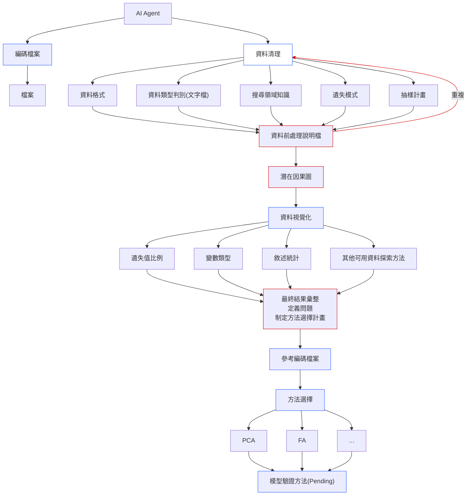

# Agent流程圖

- **編碼檔案** : 針對資料特性、研究議題、模型進行編碼，加速模型搜尋。
- **資料清理** : 將資料讀成python資料，後續資料清理之後會儲存成Parquet檔案，讓不同語言可以正確讀取。並提供資料的初步介紹，主要著重在領域背景的蒐集。
- **資料視覺化** : 將清理過後的資料進行初步的敘述統計與遺失值分析。
- **方法選擇** : 將資料清理與資料視覺化的結果彙整，並且與使用者討論要探討的問題，提案或按照標籤搜尋適合方法。
- **模型驗證方法** : 待完成，目前尚未找到可以標準化進行的驗證流程。

# Agent檔案結構

statistical-modeling/
│
├── SKILL.md
├── labeling.json
├── method_taxonomy.json
│
├── Steps/
│   ├── data-cleaning.md
│   ├── data_visualization.md
│   └── method_selection.md
│
├── statistical methods/
│   ├── variables.md
│   ├── 多重對應分析 Multiple Correspondence Analysis.md
│   └── 對應分析 Correspondence Analysis.md
│
├── code templates/
│   ├── CA.Rmd
│   └── MCA.Rmd
│
└── templates/
    ├── Data_Cleaning.md
    └── data_visualization.py

- Agent主要以`SKILL.md` 進行流程的控制，各步驟的詳細指引會到`Steps` 裡面查找。
- 各步驟的輸出皆以`markdown` 檔案為主，讓使用者可以在codex介面及時觀看每個步驟的結果，並且及時跟agent溝通修改方法或處理資料。

# 對應分析（Correspondence Analysis, CA）

## 1. 方法介紹

對應分析（Correspondence Analysis, CA）是一種探索性多變量統計方法，主要用於分析兩個類別變數之間的關聯結構，並透過低維度圖形呈現不同類別之間的相對關係。

CA 的基本資料形式為兩個類別變數所構成的列聯表（Contingency Table）。分析時，首先將列聯表轉換為相對頻率矩陣，並計算各列與各欄的邊際比例，以建立資料的獨立性基準。

其數學核心是利用卡方距離（Chi-square Distance）衡量不同列或欄的分布差異。若兩個列類別在各欄類別上的相對分布越相似，其卡方距離便越小；反之則越大。

接著，CA 透過奇異值分解（Singular Value Decomposition, SVD），將標準化後的殘差矩陣分解為數個主要維度，藉此找出列與欄類別之間最主要的關聯結構，並將原始高維度資料投影至低維度空間。

分析結果通常以**對應圖（Correspondence Map）或雙標圖（Biplot）**呈現。圖中同時展示列類別與欄類別的位置，使研究者能夠觀察不同類別之間的相對關係與關聯模式。

需要注意的是，CA 屬於探索性分析方法，圖形主要用於呈現類別分布與關聯結構，不能直接解讀為因果關係。

## 2. 數學原理

CA 的主要數學概念如下：

1. **列聯表與相對頻率：** 將兩個類別變數的交叉頻數轉換為相對頻率，並計算列與欄的邊際比例。
2. **獨立性基準：** 根據列與欄的邊際比例，建立兩個類別變數相互獨立時的期望分布。
3. **卡方距離：** 利用卡方距離衡量不同列或欄的相對分布差異，並以此定義類別之間的幾何距離。
4. **奇異值分解（SVD）：** 對標準化後的殘差矩陣進行 SVD，取得主要維度、奇異值與對應的座標。
5. **低維度表示：** 根據主要維度的解釋能力，將列與欄類別投影至二維或三維空間，以呈現資料中的主要關聯結構。

CA 的總慣量（Total Inertia）可視為列聯表偏離獨立性程度的整體衡量，其數值等於卡方統計量除以總觀察次數：

$$
\text{Total Inertia}=\frac{\chi^2}{n}
$$

其中，$\chi^2$ 為列聯表的 Pearson 卡方統計量，$n$ 為總觀察次數。

透過奇異值分解，總慣量可以分解為各維度的慣量，其數值為對應奇異值的平方。各維度所解釋的慣量比例，可用來評估低維度表示保留了多少原始資料的關聯資訊。

## 3. 雙標圖（Biplot）與結果解讀

CA 的主要視覺化結果為對應圖（Correspondence Map），也常以雙標圖（Biplot）的形式呈現列與欄類別。

雙標圖同時將列類別（Row Categories）與欄類別（Column Categories）投影至相同的低維度空間，使研究者能夠觀察兩組類別之間的相對關係。

主要解讀方式如下：

- **類別之間的距離：** 在適當的座標標準化方式下，同一組別內的類別距離可反映其分布型態的相似程度。距離越近，代表分布型態越相似。
- **列與欄類別的位置：** 列與欄類別同時出現在圖中，可協助觀察哪些列類別與哪些欄類別具有較強的相對關聯，但不能單純以兩點的歐氏距離直接判斷關聯強度。
- **原點附近的類別：** 通常代表其分布型態接近平均分布，對整體關聯結構的偏離程度較小。
- **遠離原點的類別：** 通常代表其分布型態與平均分布有較明顯的差異。
- **維度解釋比例：** 可透過各維度的慣量比例，判斷二維圖形對原始關聯結構的保留程度。

雙標圖的解讀必須考慮座標標準化方式（例如 Symmetric、Row Principal 或 Column Principal），因為不同座標設定會影響列與欄類別之間距離的幾何意義。

## 4. 使用情境

CA 適用於研究者希望探索兩個類別變數之間關聯結構的情境，例如：

- **消費者偏好分析：** 探討不同年齡層與產品偏好之間的關係。
- **市場區隔分析：** 分析不同客群與品牌選擇之間的關聯。
- **問卷調查分析：** 探索受訪者背景特徵與問卷回答類別之間的關係。
- **醫療與公共衛生：** 分析不同疾病類別與人口特徵之間的關聯。
- **社會科學研究：** 探討不同社會群體與行為類別之間的分布模式。

當研究資料包含兩個類別變數，且研究目的在於探索其關聯結構，而非進行因果推論或預測時，可以考慮使用 CA。

## 5. CA 與 MCA 的比較

多重對應分析（Multiple Correspondence Analysis, MCA）是對應分析的延伸，主要用於同時探索多個類別變數之間的關聯結構。

| 比較項目 | CA | MCA |
|---|---|---|
| 中文名稱 | 對應分析 | 多重對應分析 |
| 英文名稱 | Correspondence Analysis | Multiple Correspondence Analysis |
| 主要目的 | 探索兩個類別變數之間的關聯 | 探索多個類別變數之間的關聯結構 |
| 資料形式 | 二維列聯表 | 多個類別變數組成的資料表 |
| 數學基礎 | 卡方距離與 SVD | 卡方距離與 SVD |
| 主要分析對象 | 列與欄類別 | 個體與類別組別 |
| 主要視覺化 | 列與欄類別的對應圖 | 個體圖與類別圖 |
| 主要應用 | 兩個類別變數的關聯分析 | 多個類別變數的探索性分析 |

**方法選擇原則：**

- 當研究問題涉及兩個類別變數之間的關聯時，優先考慮 CA。
- 當研究問題涉及多個類別變數的整體關聯結構時，考慮 MCA。

兩者皆屬於探索性多變量分析方法，透過卡方距離與降維技術，將類別資料轉換為低維度的幾何表示。

# 多重對應分析（Multiple Correspondence Analysis, MCA）

## 1. 方法介紹

多重對應分析（Multiple Correspondence Analysis, MCA）是一種探索性多變量統計方法，主要用於分析多個類別變數之間的關聯結構，並透過低維度圖形呈現個體與類別組別之間的相對關係。

MCA 適用於包含多個類別變數的資料，每一列代表一個觀察個體，每一欄代表一個類別變數。由於原始資料包含多個類別變數，MCA 通常會先將資料轉換為指示矩陣（Indicator Matrix），也稱為完全指示矩陣（Complete Disjunctive Table）。矩陣中的每個欄位代表一個類別組別，並以 0 與 1 表示個體是否具有該類別特徵。

接著，MCA 利用卡方距離（Chi-square Distance）衡量個體與類別組別之間的分布差異，並透過奇異值分解（Singular Value Decomposition, SVD），將資料中的主要關聯結構投影至低維度空間。

分析結果通常以**個體圖（Individuals Map）**與**類別圖（Categories Map）**呈現，協助研究者觀察個體之間的相似性，以及不同類別組別之間的關聯模式。

MCA 屬於探索性分析方法，主要目的在於發現多個類別變數所構成的潛在結構，而非建立因果關係或進行預測。

## 2. 數學原理

MCA 的主要數學概念如下：

1. **指示矩陣（Indicator Matrix）：** 將原始類別資料轉換為 0-1 矩陣。每個類別組別形成一個欄位，個體具有該類別時記為 1，否則記為 0。
2. **相對頻率與邊際比例：** 根據指示矩陣計算各個體與類別組別的邊際比例，作為後續分析的基準。
3. **卡方距離：** 利用卡方距離衡量不同個體或類別組別之間的分布差異，使類別資料能夠以幾何距離表示。
4. **奇異值分解（SVD）：** 對標準化後的殘差矩陣進行 SVD，取得主要維度、奇異值與對應座標。
5. **低維度表示：** 根據各維度所解釋的慣量，將個體與類別組別投影至二維或三維空間，以呈現資料中的主要關聯結構。

MCA 的總慣量（Total Inertia）可用來衡量資料整體的變異程度，並可分解為各維度的慣量。各維度的慣量比例可用來評估低維度表示保留了多少原始資料的資訊。

需要注意的是，MCA 的慣量受到資料編碼方式與變數數量影響，因此解讀時應考慮其資料結構與所採用的 MCA 定義。

## 3. 個體圖與類別圖的解讀

MCA 的主要視覺化結果包含個體圖（Individuals Map）與類別圖（Categories Map），分別呈現觀察個體與各類別組別在低維度空間中的位置。

### 3.1 個體圖（Individuals Map）

個體圖將每筆觀察資料投影至低維度空間，主要用於探索個體之間的相似性與分群結構。

主要解讀方式如下：

- **個體之間的距離：** 在適當的座標尺度下，距離較近的個體通常具有較相似的類別組合；距離較遠則代表其類別組合存在較大差異。
- **個體分布：** 可觀察資料是否形成不同群集，以及是否存在與其他個體差異較大的觀察值。
- **原點附近的個體：** 通常代表其特徵組合較接近整體平均結構。
- **遠離原點的個體：** 通常代表其類別組合具有較明顯的特殊性。

### 3.2 類別圖（Categories Map）

類別圖將各個類別組別投影至低維度空間，主要用於探索不同類別組別之間的關聯模式。

主要解讀方式如下：

- **類別組別之間的距離：** 距離較近的類別組別通常具有較相似的個體分布型態。
- **類別組別的位置：** 可觀察不同變數的類別組別是否呈現相近或相反的分布模式。
- **原點附近的類別組別：** 通常代表其分布較接近整體平均，對主要維度的區分程度較低。
- **遠離原點的類別組別：** 通常代表其分布具有較明顯的特徵，可能對個體之間的差異具有較高的辨識能力。

需要注意的是，類別圖中的距離與幾何關係會受到座標標準化方式影響，不應將所有點之間的歐氏距離直接解讀為統計關聯強度。

## 4. 使用情境

MCA 適用於研究者希望同時探索多個類別變數之間關聯結構的情境，例如：

- **消費者行為分析：** 探討消費者的年齡、性別、購買習慣與品牌偏好之間的關聯。
- **市場區隔分析：** 根據消費者的生活型態、消費偏好與產品選擇，探索不同客群的特徵。
- **問卷調查分析：** 分析受訪者的背景資料、態度及行為回答之間的整體關聯。
- **醫療與公共衛生：** 探索患者的人口特徵、症狀及疾病類別之間的關聯結構。
- **社會科學研究：** 分析不同社會背景、價值觀與行為模式之間的關係。

當研究資料包含多個類別變數，且研究目的在於探索個體與類別組別之間的整體關聯結構時，可以考慮使用 MCA。
